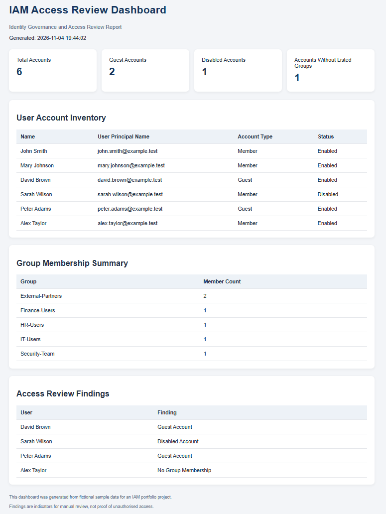

# Entra ID Access Review Reporter

**PowerShell | Microsoft Entra ID | IAM | Identity Governance | Security Automation**

## Project Overview

Entra ID Access Review Reporter is a PowerShell-based identity governance reporting project designed to automate user account reviews, guest account identification, group membership auditing and access review reporting.

The project currently uses fictional CSV-based test data to demonstrate its reporting capabilities. Microsoft Graph integration is planned as a subsequent development phase.

## Key Features

- **User Account Reporting:** Generates reports containing user identity and account information.
- **Guest Account Identification:** Identifies external guest accounts for review.
- **Disabled Account Detection:** Highlights disabled accounts for account lifecycle review.
- **Group Membership Auditing:** Generates detailed user-to-group membership reports.
- **Access Review Findings:** Identifies accounts requiring further administrative review.
- **HTML Dashboard:** Presents account statistics and review findings in a browser-based dashboard.

## Technologies

| Technology | Application |
|---|---|
| PowerShell 5.1 | Automation and report generation |
| CSV | Sample identity data and report exports |
| HTML/CSS | Access review dashboard |
| Git/GitHub | Version control and project documentation |
| Microsoft Graph | Planned integration |

## Project Structure

```text
scripts/       PowerShell automation scripts
sample-data/   Fictional test identity records
reports/       Generated reports
screenshots/   Project screenshots
docs/          Technical documentation
```

## Dashboard Preview



## Sample Test Results

The project was tested using six fictional user accounts.

| Review Metric | Result |
|---|---:|
| Accounts reviewed | 6 |
| Guest accounts | 2 |
| Disabled accounts | 1 |
| Accounts without listed groups | 1 |
| Group membership records | 6 |
| Access review findings | 4 |

These results demonstrate the current sample-data implementation, not a live Microsoft Entra ID environment.

## Running the Project

Requirements:
- Windows PowerShell 5.1 or later.
- Windows operating system.
- Fictional sample user dataset.

Run the scripts from the project root:

```powershell
.\scripts\Export-AccessReviewReport.ps1

.\scripts\New-AccessReviewFindings.ps1

.\scripts\Export-GroupMembershipAudit.ps1

.\scripts\New-AccessReviewDashboard.ps1
```

The generated reports are saved in the `reports` directory.

## Security Considerations

- Uses fictional test identities.
- Does not connect to an employer's production directory.
- Does not modify or delete user accounts.
- Does not store credentials or authentication tokens.
- Generated reports are excluded from version control.

## Roadmap

- [ ] Microsoft Graph integration.
- [ ] Entra ID user and guest account retrieval.
- [ ] Live group membership reporting.
- [ ] Inactive account review using sign-in activity data.
- [ ] Authentication-method and MFA registration reporting.
- [ ] Enhanced dashboard visualisations.
- [ ] Automated reporting.

## Author

Cybersecurity and IAM portfolio project.

Developed to demonstrate PowerShell automation, identity administration, access governance and security reporting.